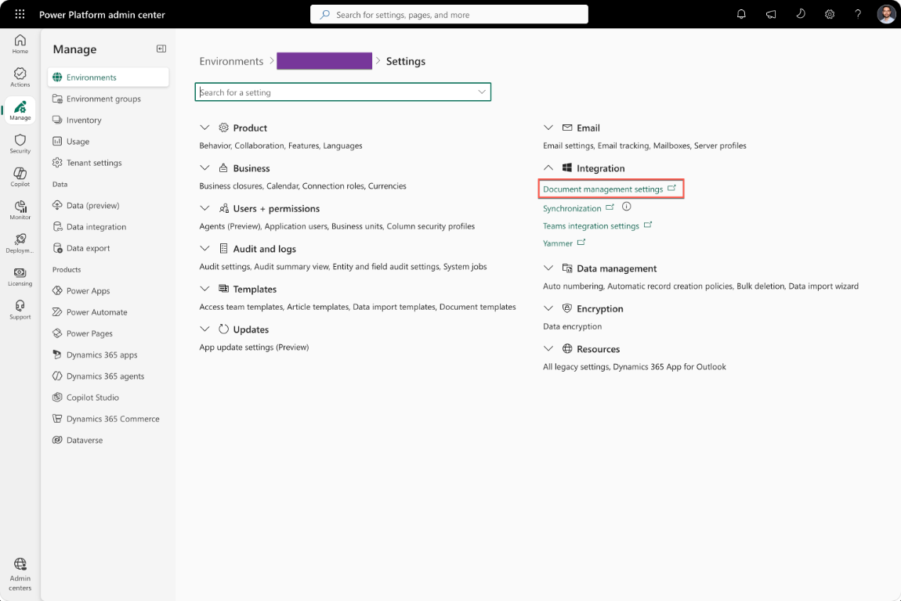
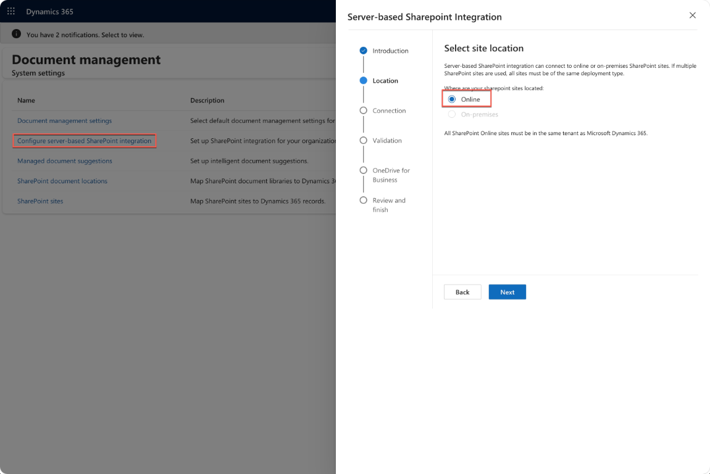
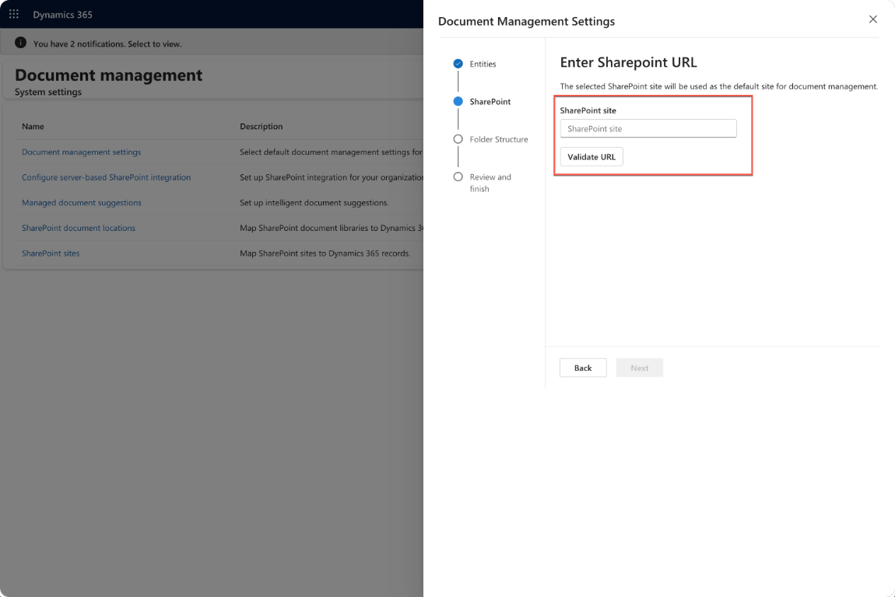
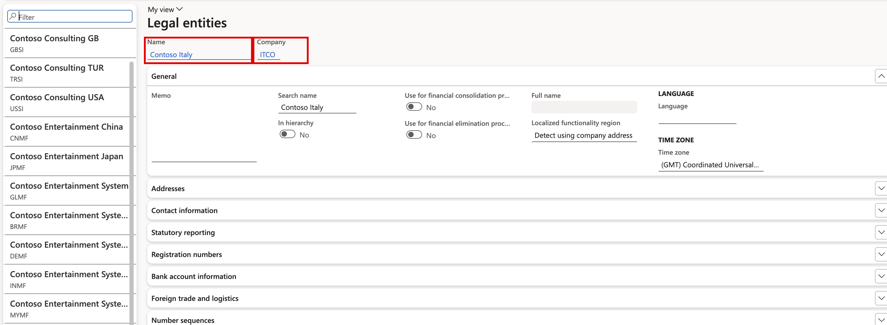
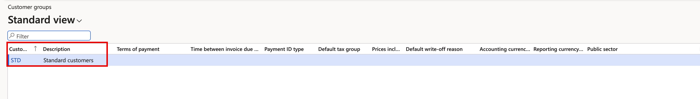
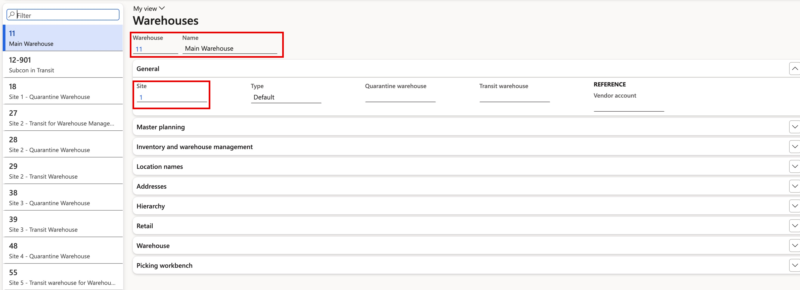
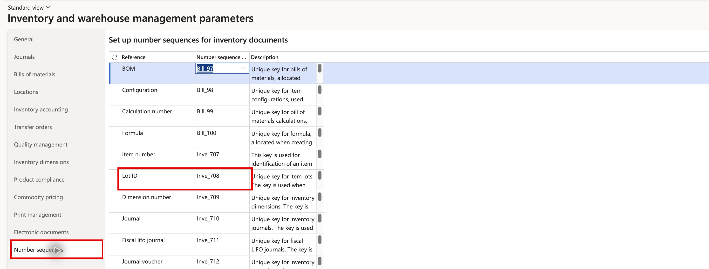

# WorkIQ Starter Pack

Demo sites, users, and content used to explore Work IQ on a demo or developer tenant.

### DO NOT USE THIS IN PRODUCTION.
The installer creates users, Teams, SharePoint content, and **writes email directly into the users' mailboxes** (tagged with the category `WorkIQStarterPack`). Only run it against a demo or developer tenant.

## Overview

The Work IQ Starter Pack is a collection of PowerShell scripts that automate the provisioning of demo users, content, and business data onto a target demo or developer tenant. It provides a consolidated knowledge base for exploring and experimenting with Work IQ, as well as for delivering consistent demos.

The pack has one installer and one cleanup script. Both handle Microsoft 365 and Dynamics 365 content; no separate Dynamics scripts are needed.

| Script | Purpose |
|---|---|
| [InstallWorkIQStarterPack.ps1](./InstallWorkIQStarterPack.ps1) | Installs the selected Microsoft 365, Dynamics 365 Sales & Customer Service, and Finance & Operations content, using shared users and an app registration. |
| [CleanUp.ps1](./CleanUp.ps1) | Selectively removes Microsoft 365 content, Dynamics 365 demo data, the Caldova solution, and Dynamics-linked SharePoint folders, with optional removal of logs and the app registration. |

[Content/content.json](./Content/content.json) describes the Microsoft 365 demo. The installer reads it and uses PnP PowerShell and Microsoft Graph to create:

- Users (demo users, or your own existing users), their licenses, and profile photos
- Microsoft Teams and their SharePoint sites, with channels
- Documents uploaded with the right authors and dates, and past Teams meetings created on each team's calendar with their transcripts (Word documents) linked from the channel
- SharePoint lists, libraries, content types, views, and managed-metadata term sets
- Teams chat history, imported with the Graph channel migration API
- Email threads, delivered to each recipient's inbox

## Requirements
- PowerShell 7.4.0 or later ([install](https://learn.microsoft.com/powershell/scripting/install/installing-powershell)). It is available for Windows, Linux and Mac.
- The `PnP.PowerShell` module. The installer installs it for the current user if it is missing. It is required to have version 3.4.1 or later.
- The `Microsoft.PowerApps.Administration.PowerShell` module, used for Dynamics provisioning. It is installed for the current user if it is missing.
- The Work IQ service principal (app ID `fdcc1f02-fc51-4226-8753-f668596af7f7`) is enabled in the course of the set up. It is required for this demo.
- A **Global Administrator** account (see [Permissions](#permissions)).
- Licenses for the users (see [Licenses](#licenses)).
- Copilot credits available in the tenant or pay-as-you-go billing enabled, for all content packs (see [Pre-requisite checks](#pre-requisite-checks)).
- An application registration. `InstallWorkIQStarterPack.ps1` can create one for you, or you can enter the client ID of an existing one when prompted.

## Configuration

### Config file
[Configuration/config.json](./Configuration/config.json) contains the default user-editable settings. The installer prompts for most of them and writes the answers back to this file. Pass `-Config <path>` to read the install choices from another JSON file and save updates to that file instead. Relative paths are resolved from your current working directory; absolute paths and files outside the repository are also supported.

```json
{
  "Settings": {
    "TenantPrefix": "contoso",
    "ClientId": "",
    "InstallDemoUsers": true,
    "InstallM365Content": true,
    "InstallDynamicsContent": true,
    "InstallDynamicsFOContent": false,
    "DeployDynamicsDocuments": false,
    "ProvisionUserEmails": true,
    "IssueTemporaryAccessPass": false,
    "TapLifetimeInMinutes": 480,
    "TapIsUsableOnce": false,
    "AppRegistrationName": "WorkIQStarterPack",
    "RealUserUpns": [
      "user1@contoso.onmicrosoft.com",
      "user2@contoso.onmicrosoft.com",
      "user3@contoso.onmicrosoft.com",
      "user4@contoso.onmicrosoft.com",
      "user5@contoso.onmicrosoft.com"
    ],
    "DynamicsEnvironmentUrl": "https://org.crm.dynamics.com",
    "DynamicsEnvironmentId": "",
    "DynamicsFOEnvironmentUrl": "https://org.operations.dynamics.com",
    "DynamicsFOLegalEntityId": "ITCO",
    "DynamicsFOCustomerGroupId": "STD",
    "DynamicsFOLanguageId": "en-us",
    "DynamicsFODeliveryTerms": "",
    "DynamicsFODeliveryMode": "",
    "DynamicsFOSalesTaxGroup": "",
    "DynamicsFOPaymentTerms": "",
    "DynamicsFOProductTemplateCompany": "ITCO",
    "DynamicsFOProductTemplateItemNumber": "ITEM",
    "DynamicsFOShippingCompany": "ITCO",
    "DynamicsFOShippingWarehouseId": "11",
    "DynamicsFOSalesCurrencyCode": "",
    "DynamicsFOShippingSiteId": ""
  }
}
```

| Setting | Description |
|---|---|
| `TenantPrefix` | The prefix of your tenant (e.g. `contoso` for contoso.sharepoint.com). It replaces the `<TENANTPREFIX>` token in `Content/content.json` and `Configuration/settings.json`. |
| `ClientId` | Client ID of an existing app registration. If empty, the installer creates one and saves its ID here. Required by `CleanUp.ps1`. |
| `InstallDemoUsers` | `true` creates the 5 built-in demo users. `false` maps the demo roles onto your own users (see [Users](#users)). |
| `InstallM365Content` | Install the Microsoft 365 content pack. At least one of Microsoft 365, Dynamics 365 Sales & Customer Service, or Finance & Operations must be selected. |
| `InstallDynamicsContent` | Install the Dynamics 365 Sales & Customer Service data, including the Caldova Field Engagement solution, and enable Dynamics license assignment. When Microsoft 365 content is also selected, this adds the Sales Team. |
| `InstallDynamicsFOContent` | Install the Dynamics 365 Finance & Operations data. Can be selected independently of the other packs. See [Finance and Operations](#finance-and-operations) for environment preparation. |
| `DeployDynamicsDocuments` | Deploy SharePoint documents connected to Sales & Customer Service records. Used when `InstallDynamicsContent` is `true`; prompted interactively or read from the selected file with `-Config`. Requires [SharePoint integration for Dataverse](#sharepoint-integration-for-dataverse). |
| `ProvisionUserEmails` | Import the demo email threads into the users' inboxes. Always on when demo users are used. |
| `IssueTemporaryAccessPass` | Demo users only. Issue a Temporary Access Pass for each demo user so they can sign in without an authenticator app (see [Temporary Access Pass](#temporary-access-pass)). Default `false`. |
| `TapLifetimeInMinutes` | Lifetime of each Temporary Access Pass in minutes (default `480`). Limited to the range the tenant policy allows. |
| `TapIsUsableOnce` | `true` makes each Temporary Access Pass single use (default `false`, multi use). Forced to `true` if the tenant policy requires it. |
| `AppRegistrationName` | Optional, used with `-Config` only. Name for a new app registration (default `WorkIQStarterPack`). |
| `RealUserUpns` | Used with `-Config` and `InstallDemoUsers: false` only. A list of 5 UPNs (see [Users](#users)). |

The main installer and cleanup use these additional settings for Dynamics operations. See [Dynamics 365 content](#dynamics-365-content).

| Setting | Description |
|---|---|
| `DynamicsEnvironmentUrl` | URL of the Dataverse environment for Sales & Customer Service (for example `https://org.crm.dynamics.com`). |
| `DynamicsEnvironmentId` | ID of the Dataverse environment. Written by the installer when it creates an environment. |

See [F&O configuration](#fo-configuration) for the Finance & Operations settings in the example above.

The Microsoft 365 content pack installs the Market Research, Finance, and Procurement teams from `content.json`. When both Microsoft 365 and Sales & Customer Service content are selected, the installer also adds the Sales Team (the site flagged `DynamicsContent`). Dynamics 365 data is provisioned directly by the same installer, even when Microsoft 365 content is not selected. [Configuration/settings.json](./Configuration/settings.json) holds the static installer data: the app registration permissions, the supported license SKUs, and the demo users.

### Unattended install
Run `./InstallWorkIQStarterPack.ps1 -Config ./Configuration/config.json` to read installation choices from that file instead of entering them at the configuration prompts. `-Config` replaces the previous `-UseConfig` switch; `-ConfigPath` is also accepted.

This mode still requires interactive authentication. Browser sign-in is used when creating or updating the app registration and when starting provisioning, including with an existing app registration. Microsoft 365 SharePoint operations can request additional sign-ins. If users are missing from Dataverse, their synchronization can also require a Power Platform browser sign-in. See [Permissions](#permissions) for app registration and admin consent requirements.

A fully non-interactive installation is not currently supported. Supporting it would require a separate assessment of authentication flows, API permissions, and user-dependent operations.

The settings it reads are `TenantPrefix` (required), `InstallDemoUsers`, `InstallM365Content`, `InstallDynamicsContent`, `InstallDynamicsFOContent`, `DeployDynamicsDocuments`, `ProvisionUserEmails`, and `ClientId` (set = use that existing app registration; empty = create one, named by `AppRegistrationName`). If `InstallDemoUsers` is false, `RealUserUpns` must contain exactly 5 UPNs.

When Sales & Customer Service is selected, configure `DynamicsEnvironmentUrl` for an existing Dataverse environment; `-Config` does not create a new environment. When F&O is selected, configure `DynamicsFOEnvironmentUrl` and the applicable [F&O settings](#fo-configuration).

The SharePoint document deployment choice is read from `DeployDynamicsDocuments`. If enabled and SharePoint integration or document management for the Account table is not ready, the installer prompts you to configure it or skip document deployment, even with `-Config`. Follow [SharePoint integration for Dataverse](#sharepoint-integration-for-dataverse) before continuing.

### Multiple configurations
Keep each tenant's configuration in a separate directory, for example `tenants/tenant-a/config.json` and `tenants/tenant-b/config.json`:

```powershell
./InstallWorkIQStarterPack.ps1 -Config ./tenants/tenant-a/config.json
./CleanUp.ps1 -Config ./tenants/tenant-a/config.json
```

For an alternative configuration, generated files are stored in a `Generated/` directory beside the selected JSON file (see [Generated files and logs](#generated-files-and-logs)). Reusing that configuration reuses its generated files. Alternative configurations in the same directory share `Generated/`; use separate directories for separate tenants. The cleanup reads the same configuration and generated files, and its choices remain interactive.

Selecting the repository's `Configuration/config.json`, either explicitly or by running without `-Config`, keeps the existing generated-file locations. Existing installations require no file migration. [Configuration/settings.json](./Configuration/settings.json), app permissions, original content, documents, and scripts are always read from the repository.

### Users
The demo needs 5 users, one for each role. With `InstallDemoUsers: true` the installer creates these demo users:

| Role | User | Title |
|---|---|---|
| Marketing | Serena Ribeiro | Market Research Analyst |
| Finance | Babak Shammas | Financial Reconciliation Lead |
| Security/Governance | Cassandra Dunn | Compliance Manager |
| Finance 2 | Charlotte Waltson | VP Procurement |
| Sales | David Power | Sales Director |

New users get a temporary password and must change it at first sign-in. The passwords are written to the installation log (see [Generated files and logs](#generated-files-and-logs)). Users that already exist are not recreated or edited (an empty usage location is filled in). Missing Office and Copilot licenses are assigned for every content pack.

To use your own users instead, answer "no" when the installer asks about demo users and enter 5 UPNs, or set `InstallDemoUsers: false` and `RealUserUpns` in the config file. Enter them in the order Marketing, Finance, Security/Governance, Finance 2, Sales. The installer looks them up in Entra ID and replaces the demo names and emails in the content with theirs. Demo user photos are only applied to demo users.

### Temporary Access Pass
By default each demo user has to set up Microsoft Authenticator (or another MFA method) at first sign-in. To avoid that, the installer can issue a [Temporary Access Pass](https://learn.microsoft.com/entra/identity/authentication/howto-authentication-temporary-access-pass) (TAP) for each demo user. This is opt-in and only applies to the built-in demo users (`InstallDemoUsers: true`); set `IssueTemporaryAccessPass: true` or answer "yes" when prompted.

- The installer only reads the tenant's TAP policy; it never changes it. If the Temporary Access Pass method is not enabled for the demo users in **Entra ID > Authentication methods > Policies**, the step is skipped with a warning and the rest of the installation continues. Ask a tenant administrator (Authentication Policy Administrator or Global Administrator) to enable it for the demo users if you want to use it.
- The code, its expiry, and whether it is single or multi use are printed once and written to the `Temporary Access Passes` section of the installation log (see [Generated files and logs](#generated-files-and-logs)). Graph does not reveal the code again, so keep the log secure and delete it once the codes are distributed.
- A user can only have one Temporary Access Pass. Running the installer again leaves existing codes alone. To generate replacements without reinstalling anything, run `./InstallWorkIQStarterPack.ps1 -Config <path> -RenewTap`. This deletes each demo user's existing code and creates a new one. Account passwords are not changed.
- The signed-in user needs a role that can manage authentication methods, for example Privileged Authentication Administrator (Global Administrator, already required, also works).
- Existing app registrations pick up the `UserAuthenticationMethod.ReadWrite.All` and `Policy.Read.All` permissions the next time the installer runs and grants admin consent.

### Licenses
For every content pack, each user needs Office apps and Microsoft 365 Copilot. These requirements can be met by separate licenses or a single Microsoft 365 E7 license. Dynamics license assignment also runs when Sales & Customer Service content is selected. The installer uses the supported SKUs from this list in [settings.json](./Configuration/settings.json):

- **Copilot:** `Microsoft_365_Copilot`, `M365_Copilot`, `M365_COPILOT_SPECIAL_BENEFIT_PROGRAMS`, `MICROSOFT_365_E7`
- **Office:** `SPE_E5`, `SPE_E3`, `SPB`, `O365_w/o_Teams_Bundle_M5`, `Microsoft_365_E3_(no_Teams)`, `O365_w/o Teams Bundle_M3`, `Microsoft_365_E3_EEA_(no_Teams)_Unattended_License`, `Microsoft_365_E5_(no_Teams)`, `MICROSOFT_365_E7`
- **Teams:** `Microsoft_Teams_Enterprise_New`, `Microsoft_Teams_EEA_New`, `Teams_Ess`, `TEAMS_ESSENTIALS_AAD`, `TEAMS_EXPLORATORY`, `MS_TEAMS_IW`, `M365_TEAMS_PREMIUM` and others listed in settings.json. Only needed when the Office license does not include Teams (its name contains `(no_Teams)` or `w/o Teams`).
- **Dynamics:** `DYN365_SALES_PREMIUM`, `D365_SALES_PRO` `D365_SALES_PRO_IW`, `DYN365_ENTERPRISE_SALES_CUSTOMERSERVICE`, `DYN365_ENTERPRISE_SALES`, `DYN365_ENTERPRISE_CUSTOMER_SERVICE`, `DYN365_FINANCE`

For a new set of 5 demo users, you need 5 available seats each of Copilot and Office, or 5 Microsoft 365 E7 seats (plus Teams if your Office SKU has no Teams). The prerequisite check counts only missing licenses and reserves each new SKU once per user, even when it covers several requirements. Existing supported licenses are checked before selecting new SKUs in the configured order.

Office and Copilot licenses are assigned through the same process for all content packs, including Dynamics-only installations (`InstallM365Content: false`). Existing supported licenses are retained, including when using your own users (`InstallDemoUsers: false`). A SKU is assigned at most once per user, and users whose requirements are already covered receive no license assignment request. The installer verifies actual assignments and stops before provisioning content if user creation or licensing fails. Ensure F&O users have the appropriate Dynamics licenses assigned separately.

### Pre-requisite checks
Before provisioning users, environments, or content, `InstallWorkIQStarterPack.ps1` checks the following for all selected content packs, including Dynamics-only installations.
- **Global Administrator:** the signed-in user holds the Global Administrator role.
- **Licenses:** enough available Copilot and Office seats for users missing those licenses (see [Licenses](#licenses)).
- **Work IQ service principal:** it exists and is enabled (the installer creates it if it is missing).
- **Copilot credits:** the tenant has Copilot credits. The installer calls the Microsoft Graph **beta** `copilot/costmanagement/gettenantcreditbalance()` endpoint and passes if the prepaid balance (purchased minus consumed) is above 0 or pay-as-you-go billing is listed. It needs the `CopilotCostManagement.Read.All` permission; if the call fails the check fails. The beta API can change.

### Permissions
The user running the installer must be a Global Administrator, because the installer creates the app registration, grants admin consent, and runs migration-related imports.

The app registration needs the permissions below. They are defined in [Configuration/appPermissions.json](./Configuration/appPermissions.json), which the installer uses to create the app registration and check it. After browser sign-in as a Global Administrator, the installer creates a new app registration or adds missing permissions to the existing one, checks existing admin consent, and grants any missing consent through Microsoft Graph REST APIs. It stops if consent cannot be completed. The Graph and SharePoint names are also listed under `AppRegistrationPermissions` in [Configuration/settings.json](./Configuration/settings.json), which is used to verify the token. Keep the two in sync.

#### Graph Delegated Permissions
- Group.ReadWrite.All (also creates the past meetings on the team calendar)
- User.ReadWrite.All
- Directory.ReadWrite.All
- Application.ReadWrite.All
- TeamMember.ReadWrite.All
- TeamsTab.ReadWrite.All (adds the lists and libraries as channel tabs)
- TeamSettings.ReadWrite.All
- AppCatalog.Read.All
- CopilotCostManagement.Read.All (Copilot credit check)
- CopilotCostManagement-Policy.Read.All (reading Copilot spending policies; optional, the check still works without it)
- UserAuthenticationMethod.ReadWrite.All (Temporary Access Pass for demo users; optional)
- Policy.Read.All (checking whether Temporary Access Pass is enabled; optional)

#### Graph Application Permissions
- Teamwork.Migrate.All (chat import)
- Mail.ReadWrite (email import)

#### SharePoint Delegated Permissions
- AllSites.FullControl
- TermStore.ReadWrite.All

#### Dynamics and Power Platform Delegated Permissions (Dynamics 365 content)
- Dynamics CRM: user_impersonation
- Dynamics ERP: Odata.FullAccess
- Power Platform API: EnvironmentManagement.Environments.Read, EnvironmentManagement.Groups.ReadWrite, EnvironmentManagement.Settings.ReadWrite

#### Certificate
The two application permissions are used with certificate authentication. The installer generates a self-signed certificate (valid for 2 years) in `Installation/.certs/` for the default configuration, or `Generated/.certs/` beside an alternative configuration, and registers the public key on the app registration. The `.pfx` contains a private key. These generated folders are git-ignored within this repository; do not commit or share them.

## Instructions
1. Run `./InstallWorkIQStarterPack.ps1`.
2. Answer the prompts: tenant prefix, demo or real users, content packs (Microsoft 365, Dynamics 365 Sales & Customer Service, and/or Finance & Operations), environment URLs where applicable, and the app registration. For Sales & Customer Service, you can choose to create a new Dataverse environment instead. If you do not already have an app registration with the required permissions above, answer "no" and the installer creates one.
3. Sign in through the browser when asked, using a Global Administrator account (see [Permissions](#permissions)). Sign-in can occur at several steps.
4. Wait for the installer to finish all selected Microsoft 365 and Dynamics operations. Answer any applicable environment creation, F&O setup, and optional Dynamics SharePoint document prompts. Some steps wait for Microsoft 365 to catch up (team and site provisioning, mailbox creation for photos and email, and consent and certificate propagation, which can take a few minutes).
5. Review the install log in `Logs/` (`InstallLog-YYYYMMDDXX.md`).

The installer can be run again. Existing Teams are kept, but their owners and members are reset. Chat history is skipped if the channel was already imported. Emails are deleted and re-delivered.

## What gets installed
- **Market Research Team** (private Team): a "Launch Readiness" channel, 9 documents, 5 past Teams meetings (with transcripts), 5 email threads, and 4 chats.
- **Finance Team** (private Team): a "Financial Investigation Cases" channel, 8 documents, 4 email threads, and 3 chats. It also gets the Supplier Directory, Financial Investigation Cases, and Procurement Exception lists, and the Contract Library. The library uses a "WorkIQ Starter Pack" term group in the tenant term store.
- **Procurement Team** (private Team): a "Capacity Planning" channel, 8 documents, 3 past Teams meetings, 4 email threads, and 3 chats. It also gets the Supplier Directory, Supplier Capacity Tracker, and RFPs lists.
- **Sales Team** (private Team, only when both `InstallM365Content` and `InstallDynamicsContent` are `true`): a "Dynamics - D365 - Sales Hub" channel, 4 documents, 3 email threads, and 2 chats.
- Profile photos for the demo users when Microsoft 365 content is selected.
- **Dynamics 365 data**, when selected: Sales & Customer Service and/or Finance & Operations content (see [Dynamics 365 content](#dynamics-365-content) and [Finance and Operations](#finance-and-operations)).

The lists and libraries are added to the first channel as tabs, and the default Notes, Wiki, and Page tabs are removed.

The sample documents live under [Content/Documents](./Content/Documents), in the Demo1 to Demo4 folders used by the sites in `content.json`. To create more, see [Generating new content](#generating-new-content).

## Generating new content
[Prompts/DocumentGenerationPrompt.md](./Content/Documents/Prompts/DocumentGenerationPrompt.md) is the prompt used to author the demo content: documents, meeting transcripts, email threads, and Teams chats. It fixes the product, supplier, and raw-material names so everything stays consistent across the demos.

You can use this prompt with GitHub Copilot, Microsoft 365 Copilot, Claude, Codex, or another assistant.

To generate new content:

1. Give the assistant the generation prompt, [Configuration/settings.json](./Configuration/settings.json) for the demo users, and [Content/content.json](./Content/content.json) for the existing content structure. With repository access, reference these files in your request. In a chat without file access, paste the prompt and the relevant JSON sections instead.
2. Ask it to generate the selected demo under `Content/Documents/<DemoName>/` and prepare the matching entries in `Content/content.json`, keeping the other demos unchanged. An example request is provided below.
3. If the assistant only returns content in chat, save or export the files into the target demo folder and apply the proposed JSON changes yourself. Use actual Word (`.docx`) and PDF files for documents, Word (`.docx`) files for meeting transcripts, and Markdown for email threads and chats, as required by the prompt.
4. Review the generated files and transcript structure against the prompt. Check that `Content/content.json` is valid JSON, references the actual files using repository-relative paths, and uses the configured demo users and consistent dates in the past.
5. Run the installer again (see [Instructions](#instructions)).

Example request (replace `<DemoName>` with the target demo folder name):

> Use the instructions in `Content/Documents/Prompts/DocumentGenerationPrompt.md`, the demo users in `Configuration/settings.json`, and the structure in `Content/content.json` to generate content for `<DemoName>`. Create the files in the required formats under `Content/Documents/<DemoName>/` and update the corresponding `Content/content.json` entries. Keep other demos unchanged. If you cannot edit the repository, return the content and proposed JSON entries for me to save and apply.

Choose the workflow for your assistant:

| Assistant | How to use it |
|---|---|
| GitHub Copilot | Open the repository in your IDE and use [agent mode](https://docs.github.com/en/copilot/how-tos/copilot-in-your-ide/use-copilot-agents/use-agent-mode). Reference the three files above and ask it to create the demo files and update the matching JSON entries. |
| Microsoft 365 Copilot | Use [Copilot Chat](https://support.microsoft.com/en-us/microsoft-365-copilot/create-content-using-microsoft-365-copilot-chat), paste the prompt and relevant JSON sections, and ask for the content and proposed entries. Save or export the files and apply the JSON changes in the repository as described above. |
| Claude | Start [Claude Code](https://code.claude.com/docs/en/quickstart) from the repository directory and reference the three files above in your request. |
| Codex | Start [Codex](https://learn.chatgpt.com/docs/projects) from the repository directory with `codex`, or open the repository in the Codex IDE extension. Reference the three files above in your request. |

To change the scenario or the names used, edit the prompt before generating the content. When regenerating an existing demo, the prompt instructs the assistant to remove the existing files in that demo folder first.

## Dynamics 365 content
`InstallWorkIQStarterPack.ps1` installs all selected Dynamics 365 demo data as part of the main installation. No separate installer or second run is needed. It reuses the shared users and app registration; the Dynamics and Power Platform permissions required by the selected operations must be consented.

The installer lets you select Dynamics 365 Sales & Customer Service data independently of the Microsoft 365 content pack. Finance & Operations (F&O) has a separate [preparation guide](#finance-and-operations). At least one of the three packs must be selected. When run interactively, it prompts for the relevant environment URLs and can create a new Dataverse environment, saving its ID and URL to the selected configuration file. Use `./InstallWorkIQStarterPack.ps1 -Config <path>` to read the configuration instead, including the optional SharePoint document deployment choice (see [Unattended install](#unattended-install)). See [Environment preparation](#environment-preparation) for the existing-environment requirements and interactive creation options.

Dynamics-only labs still require Microsoft 365 and Microsoft 365 Copilot licenses, plus Copilot credits or pay-as-you-go billing. They run the same prerequisite checks and Office and Copilot license assignment as Microsoft 365 installations; see [Licenses](#licenses) and [Pre-requisite checks](#pre-requisite-checks) for the shared requirements and the separate Dynamics license requirements.

Depending on the selected packs, it will:
- Create or resolve the selected users for all packs; synchronize them into Dataverse when Sales & Customer Service is selected.
- Install the Caldova Field Engagement managed solution from [Content/DataverseSolutions](./Content/DataverseSolutions) when Sales & Customer Service is selected.
- Create the Sales & Customer Service data in [Content/contentDynamics.json](./Content/contentDynamics.json): leads, accounts, contacts, price lists, products, opportunities, quotes, orders, invoices, cases, emails, and field engagements.
- Optionally deploy SharePoint documents connected to the Sales & Customer Service records.

All installation operations are recorded in `Logs/InstallLog-YYYYMMDDXX.md`, where `XX` is the run number for that day. Each run writes a new file, so earlier logs are kept.

### Environment preparation

**Sales & Customer Service (Dataverse)**

1. Create a Sandbox environment with a Dataverse database, or use an existing demo environment. Confirm the required Dynamics licenses and available Dataverse capacity using Microsoft's [environment creation instructions](https://learn.microsoft.com/en-us/power-platform/admin/create-environment). The shared lab licenses and installer permissions are covered in [Licenses](#licenses) and [Permissions](#permissions).
2. Select **Enable Dynamics 365 apps** when creating the database and ensure Sales and Customer Service are installed and ready. Microsoft does not allow this option to be enabled later on a database created without it. Use English (United States, LCID `1033`) to match the English security-role names used by the installer, and select the base currency for your demo.
3. For an existing environment, set `DynamicsEnvironmentUrl` to its HTTPS root URL, for example `https://org.crm.dynamics.com`. Ensure the administrator running the installer can access the environment, import solutions, and assign security roles. If an environment security group is configured, the installer adds the selected users to it.

Alternatively, run the installer interactively and choose to create a new Dataverse environment. Its defaults are Sandbox, English (`1033`), and `USD`; it saves the environment ID and URL to the selected configuration. With `-Config`, an existing environment and `DynamicsEnvironmentUrl` are required. User synchronization, solution installation, and role assignment are handled by the installer for either path.

**Enable Business Applications in Work IQ**

For the Dataverse environment, follow Microsoft's [Work IQ pilot setup (preview)](https://learn.microsoft.com/en-us/power-platform/admin/business-applications-work-iq/quickstart): confirm the demo users are included in the Microsoft 365 admin center's Business Applications in Work IQ availability setting, and turn on Work IQ under **Settings > Product > Features** in the Power Platform admin center. Review [Dataverse search indexing for AI and agent experiences](https://learn.microsoft.com/en-us/power-platform/admin/configure-relevance-search-organization#turn-on-search-indexing-to-support-dataverse-intelligence-work-iq-in-ai-and-agent-experiences) for Dataverse-backed AI experiences. These administrative settings are separate from installing the demo data and are not enabled by the starter pack.

### SharePoint integration for Dataverse

This optional setup is required only when deploying SharePoint documents for **Dynamics 365 Sales & Customer Service** (`InstallDynamicsContent: true` and `DeployDynamicsDocuments: true`). Documents are stored in SharePoint and linked to Dataverse Account records. It is separate from Business Applications in Work IQ, Microsoft 365 Teams provisioning, and F&O setup.

The starter pack checks the integration and deploys the account documents, but **does not enable server-based SharePoint integration or Account document management for you**. Configure them before document deployment, or in another browser tab when the installer asks you to do so.

#### Prerequisites

- A ready Dataverse environment with Sales & Customer Service installed (see [Environment preparation](#environment-preparation)).
- The **System Administrator** security role or equivalent permissions in that environment, in addition to the installer's [administrator requirements](#permissions).
- An existing SharePoint Online site in the **same Microsoft 365 tenant**, for example `https://contoso.sharepoint.com/sites/DataverseDemo`. Its hostname must match the configured `TenantPrefix`. Use the site URL, not a document library, folder, or sharing link. The installer can use this site even when `InstallM365Content` is `false`.
- Appropriate SharePoint permissions for the administrator to manage libraries and upload documents, and for the demo users to access those documents. Dataverse security roles do **not** automatically grant SharePoint access; assign users or groups permissions on the target site separately.

#### 1. Enable server-based SharePoint integration

1. Sign in to the [Power Platform admin center](https://admin.powerplatform.microsoft.com/).
2. Go to **Manage > Environments**, select the environment matching `DynamicsEnvironmentUrl`, and select **Settings**.
3. In the environment's Settings page, expand **Integration** in the right-hand column and click **Document management settings**, highlighted in red below, to open the configuration page.

   

4. On the Document Management page, click **Configure server-based SharePoint integration** (called **Enable server-based SharePoint integration** in some interfaces) to open the wizard.
5. Select **Next** on the introduction step. On **Select site location**, choose **Online**, highlighted in red below, and select **Next**.

   

6. On **Enter integration site URL**, enter your SharePoint site's HTTPS URL in the **URL** field, for example `https://contoso.sharepoint.com/sites/DataverseDemo`, and select **Next**.

   

7. Resolve any validation errors, continue through the remaining wizard steps, and select **Finish** to apply the configuration.

If server-based integration is already enabled, review the existing configuration instead of enabling it again. Under **SharePoint Sites** on the Document Management page, confirm the intended site is active and set as the default. The starter pack requires **exactly one active default SharePoint Online site** in Dataverse and uses that site's URL for document deployment.

See Microsoft's [server-based SharePoint Online setup instructions](https://learn.microsoft.com/en-us/power-platform/admin/set-up-dynamics-365-online-to-use-sharepoint-online). Once enabled, server-based integration cannot be reverted to the previous client-based integration.

#### 2. Enable document management for Account

1. On the same Document Management page, open **Document management settings**.
2. On **Select Entities**, select the checkbox for **Account** (logical name `account`), highlighted in red below, then select **Next**. Other tables can remain selected if required for your environment, but the starter pack's document deployment uses Account only.

   

3. On **Enter Sharepoint URL**, enter or confirm the default site's HTTPS URL in the **SharePoint site** field. Click **Validate URL**, resolve any validation errors, then select **Next**.

   

4. Complete the remaining wizard steps, including any folder-structure choices and library creation prompts, and confirm creation succeeds.
5. Open the SharePoint site's **Site contents** and verify the Account library or folder exists. The installer expects exactly one existing root named `Account`, either at the site root or inside `Documents` / `Shared Documents`. It creates the individual demo account folders, not this table-level root.

Use the English environment specified in [Environment preparation](#environment-preparation) and preserve the generated Account root. If the wizard reports a library creation error or the root is missing, resolve the document management configuration before resuming the installer.

See Microsoft's [instructions for enabling document management on specific tables](https://learn.microsoft.com/en-us/power-platform/admin/enable-sharepoint-document-management-specific-entities).

#### 3. Deploy and verify the demo documents

1. Run the installer and answer **yes** to **Do you want to deploy the SharePoint Documents connected to D365 Sales & CS?** Alternatively, set `InstallDynamicsContent` and `DeployDynamicsDocuments` to `true` in the selected configuration and run `./InstallWorkIQStarterPack.ps1 -Config <path>`.
2. If the installer is waiting for configuration, enter `ok` after completing the steps above. It rechecks the integration and Account document management. Enter `cancel` to skip document deployment and continue the remaining installation steps; this prompt can also appear with `-Config`.
3. Review the installation log for the selected default SharePoint site, the existing Account root, and successful document deployment. The configuration check is not a live SharePoint connectivity test; upload errors still need to be resolved.
4. In **Sales Hub**, open a demo account with supplied documents and select **Related > Documents**. Confirm its documents are listed and can be opened. Use **Open Location** to verify the corresponding SharePoint folder, and repeat the access check as a demo user.

If documents cannot be deployed or opened, check the environment URL, the active default site, Account document management, the Account root, and the affected user's SharePoint permissions. After correcting deployment errors, rerun the installer with the same configuration. To remove the uploaded demo account folders later, select **Dynamics SharePoint cleanup** (see [Cleanup](#cleanup)).

## Finance and Operations

The main installer creates F&O demo customers, products, and sales orders from [Content/contentDynamics.json](./Content/contentDynamics.json). Prepare an existing F&O environment and the reference records below. This pack does not require Dataverse or its SharePoint document integration.

Complete the shared [Requirements](#requirements), [Licenses](#licenses), and [Permissions](#permissions). Use an F&O account permitted to read company setup and create customers, products, and orders through OData, and an app registration with Dynamics ERP `Odata.FullAccess`. F&O licenses must be assigned separately.

> Use a legal entity ready for customer, product, and sales-order entry. Your F&O administrator must complete any additional setup required by enabled features or customizations before provisioning.

### F&O environment preparation

The screenshots show the demo company `ITCO — Contoso Italy`. All codes and currency values are examples; use the values configured in your environment.

#### 1. Select the legal entity

Open **Organization administration > Organizations > Legal entities**, choose the company, and select the same company in the F&O company picker. Record its **Company** code. If a new company is needed, follow [Create a legal entity](https://learn.microsoft.com/en-us/dynamics365/fin-ops-core/fin-ops/organization-administration/tasks/create-legal-entity) and complete its functional setup before provisioning.



#### 2. Configure the ledger accounting currency

In that company, open **General ledger > Ledger setup > Ledger** and populate **Accounting currency**. See [Configure ledgers — accounting currency](https://learn.microsoft.com/en-us/dynamics365/finance/general-ledger/configure-ledger#configuring-currencies-for-the-ledger). The installer uses this currency for customers and orders; setting it in JSON does not replace ledger configuration.


#### 3. Prepare a customer group

Open **Accounts receivable > Setup > Customer groups**. Create or select a group in the company and record its **Customer group** code. See [Configure Accounts receivable](https://learn.microsoft.com/en-us/dynamics365/finance/accounts-receivable/accounts-receivables-set-up-overview) for applicable defaults.



#### 4. Prepare a released product as the setup template

If demo products need releasing, choose an existing sales-ready item in **Product information management > Products > Released products** in the same company. Confirm these fields are populated:

- **General > Item model group**.
- **Manage costs > Item group**.
- **Unit** in each of **Purchase**, **Sell**, and **Manage inventory**.

Record its company and **Item number**, which can differ from the Product number. Its storage and tracking dimensions must be compatible with the shipping site and warehouse. The installer creates the demo products.


#### 5. Prepare the shipping warehouse and site

Open **Inventory management > Setup > Inventory breakdown > Warehouses**. Select a warehouse in the same company with **Site** assigned. Record its company and **Warehouse** code; the site is derived automatically. Ensure any required location or warehouse-process setup is compatible with the chosen product.



#### 6. Check automatic numbering

In **Accounts receivable > Setup > Accounts receivable parameters > Number sequences**, ensure the **Sales order** reference has a sequence configured for automatic numbering.


In **Inventory management > Setup > Inventory and warehouse management parameters > Number sequences**, check the **Lot ID** reference for inventory transactions in the same way.



Configure missing associations using [Number sequences overview](https://learn.microsoft.com/en-us/dynamics365/fin-ops-core/fin-ops/organization-administration/number-sequence-overview). The inventory-numbering prerequisite is documented in [Sales order lines V2](https://learn.microsoft.com/en-us/dynamics365/fin-ops-core/dev-itpro/data-entities/entity-sales-order-lines-v2-salesorderline#issues-and-considerations).

### F&O configuration

Set these values under `Settings` in your [configuration file](#configuration). Interactive selections are saved for reuse with `-Config`. When multiple records are available, `-Config` needs valid saved selections; a single available record is selected automatically.

| Setting | Description |
|---|---|
| `DynamicsFOEnvironmentUrl` | HTTPS root URL, for example `https://org.operations.dynamics.com`, without an application path, query string, or fragment. |
| `DynamicsFOLegalEntityId` | Company code of the prepared legal entity. |
| `DynamicsFOCustomerGroupId` | Existing customer group code in that company. |
| `DynamicsFOLanguageId` | Language for new customers; defaults to `en-us` when empty. |
| `DynamicsFOProductTemplateCompany`, `DynamicsFOProductTemplateItemNumber` | Company and Item number of the released setup item. The company must match `DynamicsFOLegalEntityId`. |
| `DynamicsFOShippingCompany`, `DynamicsFOShippingWarehouseId` | Company and shipping warehouse code. The company must match `DynamicsFOLegalEntityId`. |
| `DynamicsFODeliveryTerms` | Optional terms-of-delivery code for new customers. |
| `DynamicsFODeliveryMode` | Optional mode-of-delivery code for new customers. |
| `DynamicsFOSalesTaxGroup` | Optional sales tax group code for new customers. |
| `DynamicsFOPaymentTerms` | Optional payment terms code for new customers. |
| `DynamicsFOSalesCurrencyCode` | Populated automatically from the ledger accounting currency; no manual value is required. |
| `DynamicsFOShippingSiteId` | Populated automatically from the selected warehouse; no manual value is required. |

Add the four optional delivery, tax, and payment settings manually when your environment requires them or you want explicit defaults; they are not prompted. Leave them empty only if F&O supplies suitable defaults or permits blanks. They apply to new customers; existing customers are not updated.

Before provisioning, confirm that the shared prerequisites are met, the customer group, setup item and warehouse belong to the chosen company, and numbering and saved configuration are ready.

Set `InstallDynamicsFOContent` to `true`, or answer **No** to Microsoft 365, **No** to Sales & Customer Service, and **Yes** to F&O for an interactive F&O-only installation. Continue with the shared [Instructions](#instructions).

## Generated files and logs
For the default `Configuration/config.json`, these locations are unchanged and git-ignored:
- `Content/content.custom.json`: the content with your tenant prefix and users applied. It also records the imported email message IDs.
- `Configuration/users.custom.json`: your resolved users (real users only).
- `Installation/.certs/`: the certificate.
- `Logs/InstallLog-YYYYMMDDXX.md` and `Logs/CleanUpLog-YYYYMMDDXX.md` (one file per run): a run summary, your inputs, and the actions taken for all selected Microsoft 365 and Dynamics operations. The install log also lists the demo user passwords in plain text, so store or delete it securely.
- `Installation/.state/imported-posts.json`: the record of meeting posts already imported into each channel.
- `Logs/InstallLog.md` and `Logs/CleanUpLog.md`: a run summary, your inputs, and the actions taken for all selected Microsoft 365 and Dynamics operations. The install log also lists the demo user passwords in plain text, so store or delete it securely.

Alternative configurations use the following directory beside the selected JSON file:

```text
Generated/
├── content.custom.json
├── users.custom.json
├── .state/imported-posts.json
├── .certs/
└── Logs/
    ├── InstallLog.md
    └── CleanUpLog.md
```

`Generated/` directories within this repository are git-ignored. Files generated outside this repository need the same care: certificates contain private keys and installation logs can contain temporary passwords. The cleanup uses only the generated paths associated with the selected configuration and retains its existing choices for removing files, logs, and the app registration's certificate.

## Cleanup
Run `./CleanUp.ps1` to selectively remove what the installer created, including Dynamics 365 data. Pass `-Config <path>` to use an alternative configuration and its generated files. It is always interactive and requires PowerShell 7.4 or later and an existing app registration with the required permissions and admin consent already granted. It prompts for the tenant prefix and client ID, using the selected configuration values as defaults. Use `InstallWorkIQStarterPack.ps1` to create or configure the app registration before cleanup if needed.

It asks which operations to perform:
- **Microsoft 365 cleanup:** remove imported emails, delete the Teams in `content.json` with their M365 groups and sites and purge them from the recycle bins, delete and purge the built-in demo users, and delete the generated custom files. This includes the Sales Team site. Real users are not deleted, and the Entra security groups described in [Overview](#overview) are retained.
- **Sales & Customer Service cleanup:** delete the demo records identified in `Content/contentDynamics.json`, including field engagements, emails, cases, invoices, orders, quotes, opportunities, product catalog records, leads, and accounts. You can also choose to uninstall the Caldova Field Engagement managed solution, which removes its custom table, app, and any remaining field engagement records.
- **Finance & Operations cleanup:** delete the demo sales orders and their lines, customers in the configured legal entity, and shared products. Shared products apply across companies.
- **Dynamics SharePoint cleanup:** remove the uploaded account folders and their contents from the Sales & Customer Service SharePoint integration.
- **Optional local and app cleanup:** delete installation logs and/or remove the app registration, its service principal, and the local Teams chat migration certificate. Only delete the app registration if the installer created it, not if you supplied a pre-existing one.

Dynamics cleanup prompts for the relevant environment URLs, using saved values as defaults. F&O cleanup also requires `DynamicsFOLegalEntityId` in the configuration. Selecting Dynamics cleanup does not automatically select Microsoft 365 cleanup or delete users and Teams.

All selected cleanup operations are recorded in `Logs/CleanUpLog-YYYYMMDDXX.md`, unless you choose to delete the logs.

If a site cannot be fully removed (it stays active, is not confirmed purged from the recycle bin, or an error occurs), the cleanup lists those sites at the end with the reason. Remove them manually in the SharePoint admin center, from both Active sites and Deleted sites, and purge any matching deleted group in the Microsoft 365 admin center.

## Author(s)
- [Derek Cash-Peterson](https://www.linkedin.com/in/dcashpeterson/), MVP (Sympraxis Consulting)
- [Fabio Franzini](https://www.linkedin.com/in/fabiofranzini/), MVP (Apvee Solutions Srl)
- [Guido Preite](https://www.linkedin.com/in/guidopreite/), MVP (Apvee Solutions Srl)

## Disclaimer
THIS CODE IS PROVIDED AS IS WITHOUT WARRANTY OF ANY KIND, EITHER EXPRESS OR IMPLIED, INCLUDING ANY IMPLIED WARRANTIES OF FITNESS FOR A PARTICULAR PURPOSE, MERCHANTABILITY, OR NON-INFRINGEMENT.

## Change Log
For a list of issues/updates made in each release see the [CHANGELOG](./CHANGELOG.md).

## Security

Microsoft takes the security of our software products and services seriously, which
includes all source code repositories in our GitHub organizations.

**Please do not report security vulnerabilities through public GitHub issues.**

For security reporting information, locations, contact information, and policies,
please review the latest guidance for Microsoft repositories at
[https://aka.ms/SECURITY.md](https://aka.ms/SECURITY.md).
