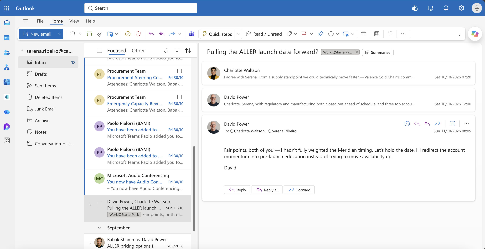
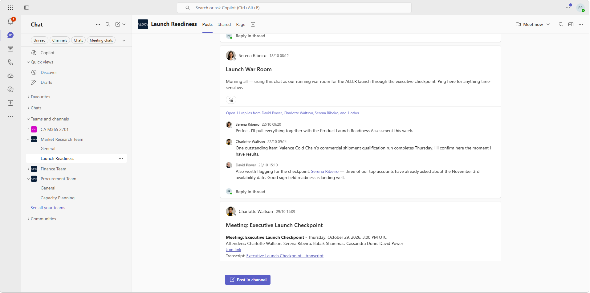
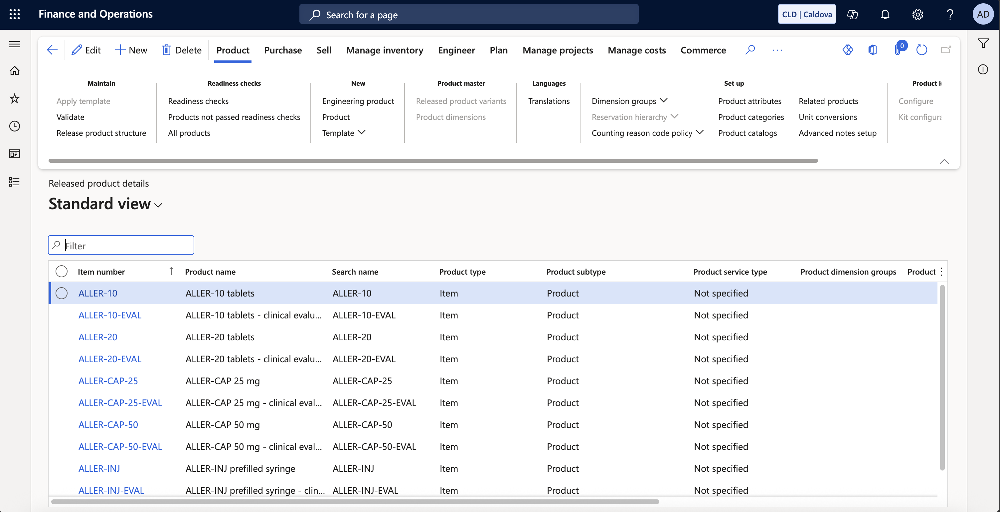

# WorkIQ Starter Pack

Demo sites, users, and content used to explore Work IQ on a demo or developer tenant.

### DO NOT USE THIS IN PRODUCTION.
The installer creates users, Teams, SharePoint sites, and **writes emails directly into the users' mailboxes** (tagged with the category `WorkIQStarterPack`), chat messages into the Teams channels, and uploads documents in SharePoint Online and Teams channels. It can also upload business data in Dynamics 365 (Sales, Customer Service, and Finance and Operations).
Only run it against a demo or developer tenant.

## Overview

The Work IQ Starter Pack is a collection of PowerShell scripts that automate the provisioning of demo users, content, and business data onto a target demo or developer tenant. It provides a consolidated knowledge base for exploring and experimenting with Work IQ, as well as for delivering consistent demos. The whole content is based on the fictitious Caldova Pharmaceuticals company used by Microsft as demo company.

Here you can see a sample of a fictitious email thread in Outlook.

Here you can see a sample of a fictitious launch-readiness discussions in Teams.

And here you can see fictitious products in Dynamics 365 Finance and Operations.

## Installation

The pack has one installer and one cleanup script. Both handle Microsoft 365 and Dynamics 365 content; no separate Dynamics scripts are needed.

| Script | Purpose |
|---|---|
| [InstallWorkIQStarterPack.ps1](./InstallWorkIQStarterPack.ps1) | Installs the selected Microsoft 365, Dynamics 365 Sales, Customer Service, and Finance and Operations content, using shared users and an app registration. |
| [CleanUp.ps1](./CleanUp.ps1) | Selectively removes Microsoft 365 content, Dynamics 365 demo data, the Caldova solution, and Dynamics-linked SharePoint folders, with optional removal of logs and the app registration. |

[Content/content.json](./Content/content.json) describes the Microsoft 365 demo. The installer reads it and uses PnP PowerShell and Microsoft Graph to create:

- Users (5 demo users, or your own existing users), their licenses, and profile photos
- Microsoft Teams and their SharePoint sites, with channels
- Documents uploaded with the right authors and dates, and past Teams meetings created on each team's calendar with their transcripts (Word documents) linked from the channel
- SharePoint lists, libraries, content types, views, and managed-metadata term sets
- Teams chat history, imported with the Graph channel migration API
- Email threads, delivered to each recipient's inbox
- Dynamics 365 Sales, Customer Service, and Finance and Operations data plus a custom Power App with persistence storage on Microsoft Dataverse

Read the [user manual](./USER-MANUAL.md) for detailed instructions on running the scripts and configuring their input parameters and settings.

## Labs

Hands-on labs are available in the [Labs directory](./Labs/README.md) to help you explore Work IQ using the demo data provided by the Work IQ Starter Pack. The labs leverage Copilot Chat, Copilot Cowork, Copilot Studio, and more, giving you opportunities to experiment across different Copilot experiences and tools. Use the labs as a starting point to ask questions, discover connections across emails, Teams conversations, documents, and business data, and see how Work IQ brings this information together. We invite you to try your own prompts, explore different scenarios, and build on the exercises to create demos tailored to your interests. Keep your experiments in a demo or developer tenant, and use the fictitious Caldova Pharmaceuticals data to learn and discover what is possible.

## Releases

| Version | Release date | Description |
|---|---|---|
| 1.0.0 | 2026-11-10 | Initial release |

## Author(s)
- [Derek Cash-Peterson](https://www.linkedin.com/in/dcashpeterson/), MVP (Sympraxis Consulting)
- [Fabio Franzini](https://www.linkedin.com/in/fabiofranzini/), MVP (Apvee Solutions Srl)
- [Guido Preite](https://www.linkedin.com/in/guidopreite/), MVP (Apvee Solutions Srl)

## Disclaimer
THIS CODE IS PROVIDED AS IS WITHOUT WARRANTY OF ANY KIND, EITHER EXPRESS OR IMPLIED, INCLUDING ANY IMPLIED WARRANTIES OF FITNESS FOR A PARTICULAR PURPOSE, MERCHANTABILITY, OR NON-INFRINGEMENT.

## Change Log
For a list of issues/updates made in each release see the [CHANGELOG](./CHANGELOG.md).

## Security

Microsoft takes the security of our software products and services seriously, which
includes all source code repositories in our GitHub organizations.

**Please do not report security vulnerabilities through public GitHub issues.**

For security reporting information, locations, contact information, and policies,
please review the latest guidance for Microsoft repositories at
[https://aka.ms/SECURITY.md](https://aka.ms/SECURITY.md).
