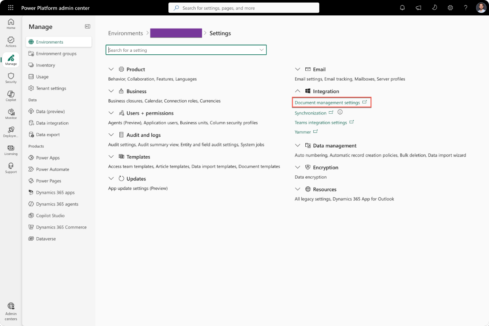
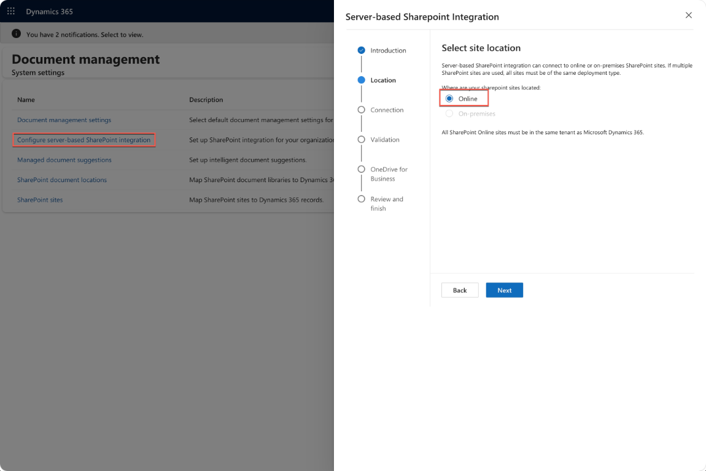
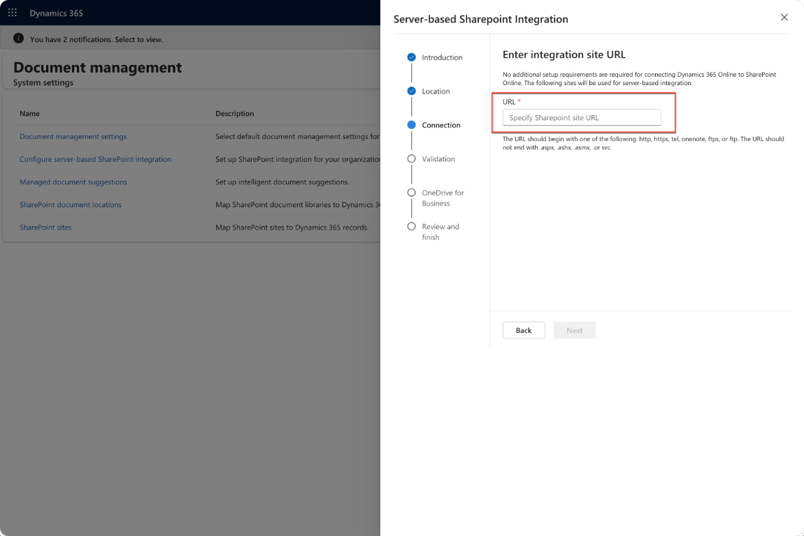
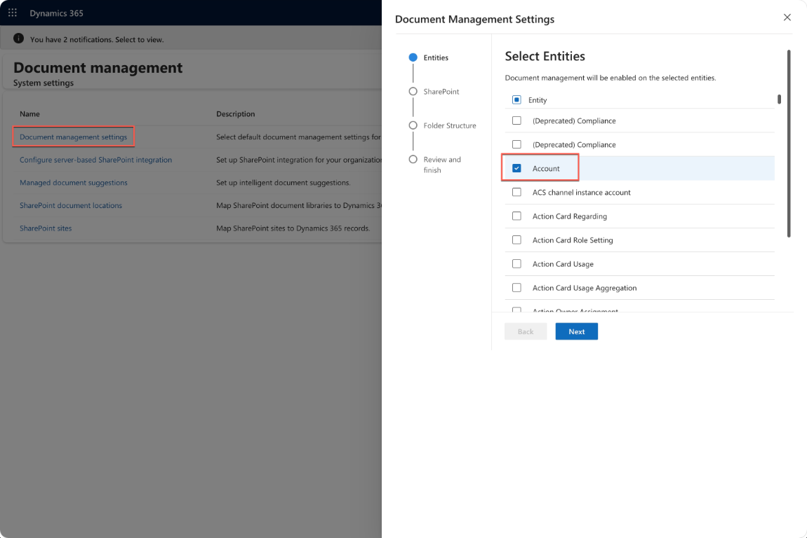
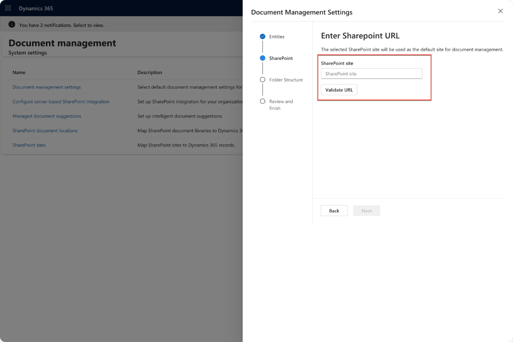

# Dynamics 365 content

[Back to README](../README.md)

`InstallWorkIQStarterPack.ps1` installs all selected Dynamics 365 demo data as part of the main installation. No separate installer or second run is needed. It reuses the shared users and app registration; the Dynamics and Power Platform permissions required by the selected operations must be consented.

The installer lets you select Dynamics 365 Sales & Customer Service data independently of the Microsoft 365 content pack. Finance & Operations (F&O) has a separate [preparation guide](./finance-and-operations.md). At least one of the three packs must be selected. When run interactively, it prompts for the relevant environment URLs and can create a new Dataverse environment, saving its ID and URL to the selected configuration file. Use `./InstallWorkIQStarterPack.ps1 -Config <path>` to read the configuration instead, including the optional SharePoint document deployment choice (see [Unattended install](../README.md#unattended-install)). See [Environment preparation](#environment-preparation) for the existing-environment requirements and interactive creation options.

Dynamics-only labs still require Microsoft 365 and Microsoft 365 Copilot licenses, plus Copilot credits or pay-as-you-go billing. They run the same prerequisite checks and Office and Copilot license assignment as Microsoft 365 installations; see [Licenses](../README.md#licenses) and [Pre-requisite checks](../README.md#pre-requisite-checks) for the shared requirements and the separate Dynamics license requirements.

Depending on the selected packs, it will:
- Create or resolve the selected users for all packs; synchronize them into Dataverse when Sales & Customer Service is selected.
- Install the Caldova Field Engagement managed solution from [Content/DataverseSolutions](../Content/DataverseSolutions) when Sales & Customer Service is selected.
- Create the Sales & Customer Service data in [Content/contentDynamics.json](../Content/contentDynamics.json): leads, accounts, contacts, price lists, products, opportunities, quotes, orders, invoices, cases, emails, and field engagements.
- Optionally deploy SharePoint documents connected to the Sales & Customer Service records.

All installation operations are recorded in `Logs/InstallLog-YYYYMMDDXX.md`, where `XX` is the run number for that day. Each run writes a new file, so earlier logs are kept.

## Environment preparation

**Sales & Customer Service (Dataverse)**

1. Create a Sandbox environment with a Dataverse database, or use an existing demo environment. Confirm the required Dynamics licenses and available Dataverse capacity using Microsoft's [environment creation instructions](https://learn.microsoft.com/en-us/power-platform/admin/create-environment). The shared lab licenses and installer permissions are covered in [Licenses](../README.md#licenses) and [Permissions](../README.md#permissions).
2. Select **Enable Dynamics 365 apps** when creating the database and ensure Sales and Customer Service are installed and ready. Microsoft does not allow this option to be enabled later on a database created without it. Use English (United States, LCID `1033`) to match the English security-role names used by the installer, and select the base currency for your demo.
3. For an existing environment, set `DynamicsEnvironmentUrl` to its HTTPS root URL, for example `https://org.crm.dynamics.com`. Ensure the administrator running the installer can access the environment, import solutions, and assign security roles. If an environment security group is configured, the installer adds the selected users to it.

Alternatively, run the installer interactively and choose to create a new Dataverse environment. Its defaults are Sandbox, English (`1033`), and `USD`; it saves the environment ID and URL to the selected configuration. With `-Config`, an existing environment and `DynamicsEnvironmentUrl` are required. User synchronization, solution installation, and role assignment are handled by the installer for either path.

**Enable Business Applications in Work IQ**

For the Dataverse environment, follow Microsoft's [Work IQ pilot setup (preview)](https://learn.microsoft.com/en-us/power-platform/admin/business-applications-work-iq/quickstart): confirm the demo users are included in the Microsoft 365 admin center's Business Applications in Work IQ availability setting, and turn on Work IQ under **Settings > Product > Features** in the Power Platform admin center. Review [Dataverse search indexing for AI and agent experiences](https://learn.microsoft.com/en-us/power-platform/admin/configure-relevance-search-organization#turn-on-search-indexing-to-support-dataverse-intelligence-work-iq-in-ai-and-agent-experiences) for Dataverse-backed AI experiences. These administrative settings are separate from installing the demo data and are not enabled by the starter pack.

## SharePoint integration for Dataverse

This optional setup is required only when deploying SharePoint documents for **Dynamics 365 Sales & Customer Service** (`InstallDynamicsContent: true` and `DeployDynamicsDocuments: true`). Documents are stored in SharePoint and linked to Dataverse Account records. It is separate from Business Applications in Work IQ, Microsoft 365 Teams provisioning, and F&O setup.

The starter pack checks the integration and deploys the account documents, but **does not enable server-based SharePoint integration or Account document management for you**. Configure them before document deployment, or in another browser tab when the installer asks you to do so.

### Prerequisites

- A ready Dataverse environment with Sales & Customer Service installed (see [Environment preparation](#environment-preparation)).
- The **System Administrator** security role or equivalent permissions in that environment, in addition to the installer's [administrator requirements](../README.md#permissions).
- An existing SharePoint Online site in the **same Microsoft 365 tenant**, for example `https://contoso.sharepoint.com/sites/DataverseDemo`. Its hostname must match the configured `TenantPrefix`. Use the site URL, not a document library, folder, or sharing link. The installer can use this site even when `InstallM365Content` is `false`.
- Appropriate SharePoint permissions for the administrator to manage libraries and upload documents, and for the demo users to access those documents. Dataverse security roles do **not** automatically grant SharePoint access; assign users or groups permissions on the target site separately.

### 1. Enable server-based SharePoint integration

1. Sign in to the [Power Platform admin center](https://admin.powerplatform.microsoft.com/).
2. Go to **Manage > Environments**, select the environment matching `DynamicsEnvironmentUrl`, and select **Settings**.
3. In the environment's Settings page, expand **Integration** in the right-hand column and click **Document management settings**, highlighted in red below, to open the configuration page.

   

4. On the Document Management page, click **Configure server-based SharePoint integration** (called **Enable server-based SharePoint integration** in some interfaces) to open the wizard.
5. Select **Next** on the introduction step. On **Select site location**, choose **Online**, highlighted in red below, and select **Next**.

   

6. On **Enter integration site URL**, enter your SharePoint site's HTTPS URL in the **URL** field, for example `https://contoso.sharepoint.com/sites/DataverseDemo`, and select **Next**.

   

7. Resolve any validation errors, continue through the remaining wizard steps, and select **Finish** to apply the configuration.

If server-based integration is already enabled, review the existing configuration instead of enabling it again. Under **SharePoint Sites** on the Document Management page, confirm the intended site is active and set as the default. The starter pack requires **exactly one active default SharePoint Online site** in Dataverse and uses that site's URL for document deployment.

See Microsoft's [server-based SharePoint Online setup instructions](https://learn.microsoft.com/en-us/power-platform/admin/set-up-dynamics-365-online-to-use-sharepoint-online). Once enabled, server-based integration cannot be reverted to the previous client-based integration.

### 2. Enable document management for Account

1. On the same Document Management page, open **Document management settings**.
2. On **Select Entities**, select the checkbox for **Account** (logical name `account`), highlighted in red below, then select **Next**. Other tables can remain selected if required for your environment, but the starter pack's document deployment uses Account only.

   

3. On **Enter Sharepoint URL**, enter or confirm the default site's HTTPS URL in the **SharePoint site** field. Click **Validate URL**, resolve any validation errors, then select **Next**.

   

4. Complete the remaining wizard steps, including any folder-structure choices and library creation prompts, and confirm creation succeeds.
5. Open the SharePoint site's **Site contents** and verify the Account library or folder exists. The installer expects exactly one existing root named `Account`, either at the site root or inside `Documents` / `Shared Documents`. It creates the individual demo account folders, not this table-level root.

Use the English environment specified in [Environment preparation](#environment-preparation) and preserve the generated Account root. If the wizard reports a library creation error or the root is missing, resolve the document management configuration before resuming the installer.

See Microsoft's [instructions for enabling document management on specific tables](https://learn.microsoft.com/en-us/power-platform/admin/enable-sharepoint-document-management-specific-entities).

### 3. Deploy and verify the demo documents

1. Run the installer and answer **yes** to **Do you want to deploy the SharePoint Documents connected to D365 Sales & CS?** Alternatively, set `InstallDynamicsContent` and `DeployDynamicsDocuments` to `true` in the selected configuration and run `./InstallWorkIQStarterPack.ps1 -Config <path>`.
2. If the installer is waiting for configuration, enter `ok` after completing the steps above. It rechecks the integration and Account document management. Enter `cancel` to skip document deployment and continue the remaining installation steps; this prompt can also appear with `-Config`.
3. Review the installation log for the selected default SharePoint site, the existing Account root, and successful document deployment. The configuration check is not a live SharePoint connectivity test; upload errors still need to be resolved.
4. In **Sales Hub**, open a demo account with supplied documents and select **Related > Documents**. Confirm its documents are listed and can be opened. Use **Open Location** to verify the corresponding SharePoint folder, and repeat the access check as a demo user.

If documents cannot be deployed or opened, check the environment URL, the active default site, Account document management, the Account root, and the affected user's SharePoint permissions. After correcting deployment errors, rerun the installer with the same configuration. To remove the uploaded demo account folders later, select **Dynamics SharePoint cleanup** (see [Cleanup](../README.md#cleanup)).
