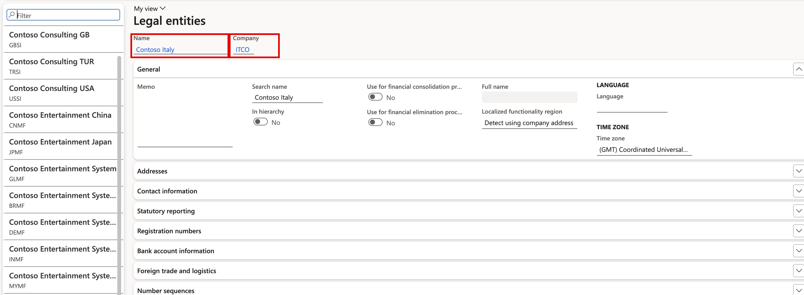
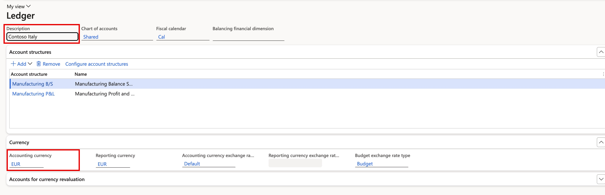
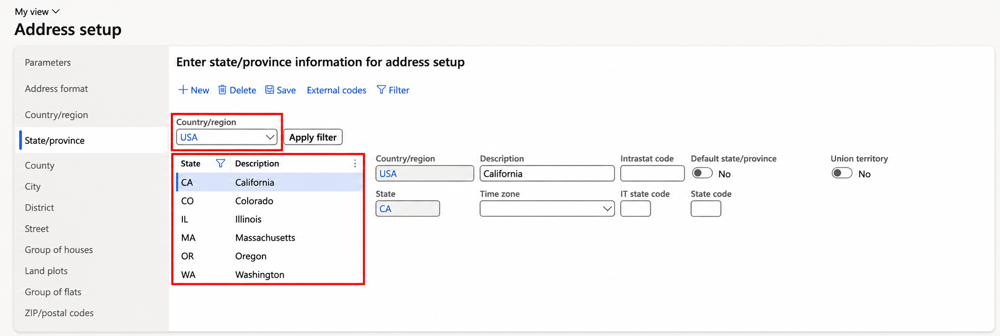
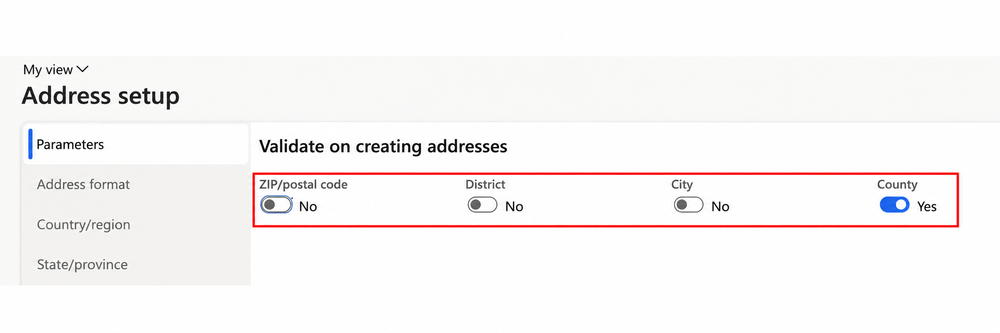
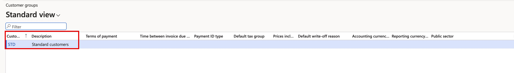
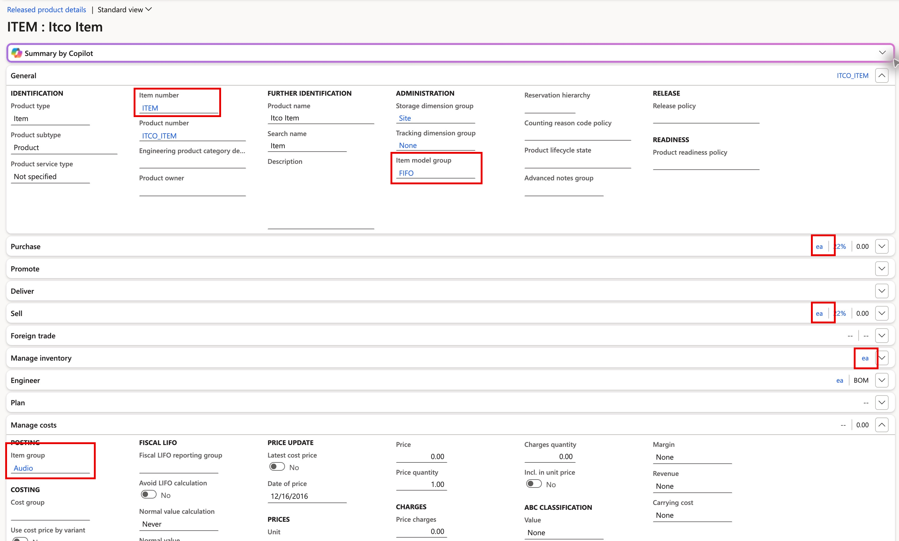
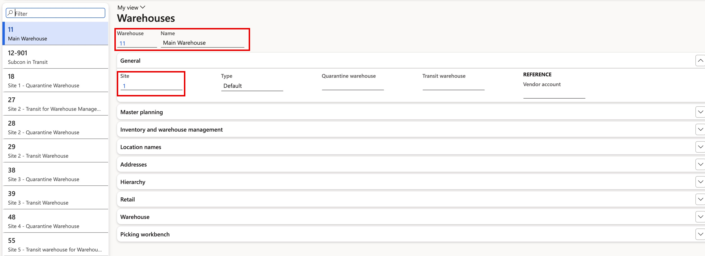
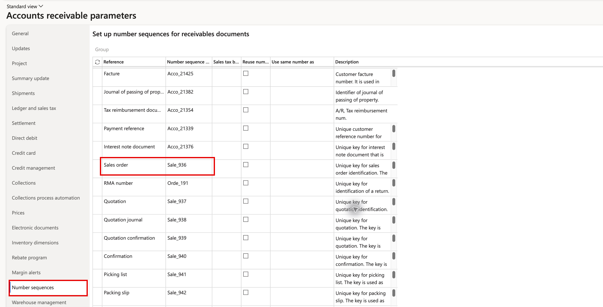
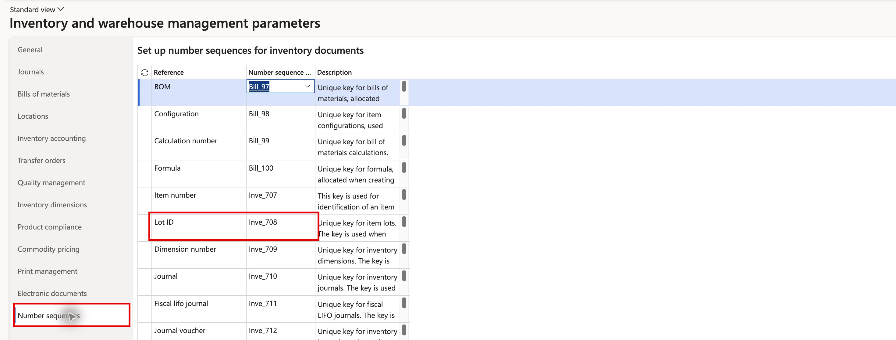

# Finance and Operations

[Back to README](../README.md)

The main installer creates F&O demo customers, products, and sales orders from [Content/contentDynamics.json](../Content/contentDynamics.json). Prepare an existing F&O environment and the reference records below. This pack does not require Dataverse or its SharePoint document integration.

Before creating demo data, the installer checks the two Finance persona users (Finance and Finance 2, including their selected real-user replacements) in F&O. It creates missing users with the selected company as their default, enables disabled users, and assigns or re-enables the **Sales Clerk** security role. Existing enabled users and assignments are reused. The signed-in administrator needs permission to maintain system users and security role assignments. Provisioning stops if these checks or changes fail. F&O cleanup retains these users and role assignments.

Complete the shared [Requirements](../README.md#requirements), [Licenses](../README.md#licenses), and [Permissions](../README.md#permissions). The browser sign-in account used by the installer must also have F&O access to the selected company, with permission to read company setup and create customers, products, and orders through OData. Use an app registration with Dynamics ERP `Odata.FullAccess`. F&O licenses must be assigned separately.

Provisioning creates sales-order headers and lines. It does not confirm, ship, invoice, or post the orders, or apply the source order statuses. Complete the additional fiscal, posting, and warehouse execution setup before performing those operations manually.

> Use a legal entity ready for customer, product, and sales-order entry. Your F&O administrator must complete any additional setup required by enabled features or customizations before provisioning.

## F&O environment preparation

The screenshots show the demo company `ITCO — Contoso Italy`. Company-specific codes and currency values are examples; use the values configured in your environment. The USA address codes below match the supplied demo customers.

### 1. Select the legal entity

Open **Organization administration > Organizations > Legal entities**, choose the company, and select the same company in the F&O company picker. Record its **Company** code. If a new company is needed, follow [Create a legal entity](https://learn.microsoft.com/en-us/dynamics365/fin-ops-core/fin-ops/organization-administration/tasks/create-legal-entity) and complete its functional setup before provisioning.

### 2. Configure the ledger accounting currency

In that company, open **General ledger > Ledger setup > Ledger** and populate **Accounting currency**. See [Configure ledgers — accounting currency](https://learn.microsoft.com/en-us/dynamics365/finance/general-ledger/configure-ledger#configuring-currencies-for-the-ledger). The installer uses this currency for customers and orders; setting it in JSON does not replace ledger configuration.

### 3. Prepare USA address reference data

Open **Organization administration > Global address book > Addresses > Address setup**. On **Country/region**, confirm that country code **USA** exists and has an **Address format** assigned. On **State/province**, select **USA** in the **Country/region** filter and select **Apply filter**. Verify these exact state codes, creating any missing entries with **New**:

| State code | State name | Demo customer city |
|---|---|---|
| `MA` | Massachusetts | Boston |
| `IL` | Illinois | Chicago |
| `WA` | Washington | Seattle |
| `CO` | Colorado | Denver |
| `CA` | California | San Diego |
| `OR` | Oregon | Portland |

These are the supplied customers' address codes even when the selected legal entity is outside the United States, such as `ITCO`. The installer uses `USA` for these addresses and does not create country, state, or city reference records. See [Address setup](https://learn.microsoft.com/en-us/dynamics365/fin-ops-core/dev-itpro/organization-administration/global-address-book-address-setup) for country and state configuration.

On **Parameters**, review **Validate on creating addresses**. If **City** validation is enabled, configure the six cities above under `USA`, associated with their respective states. Review any other enabled address checks and their required reference data. The installer sends blank street, ZIP/postal code, and county values; verify that your environment's address rules accept those blanks before provisioning. See [Define address parameters](https://learn.microsoft.com/en-us/dynamics365/fin-ops-core/dev-itpro/organization-administration/global-address-book-address-setup#define-address-parameters).

The validation settings shown are examples from the demo environment. Review the options required by your environment. An installation error such as `The value 'MA' in field 'State' is not found in the related table 'States'` means that F&O could not resolve the submitted state code for the address; check its association with `USA` before rerunning.

### 4. Prepare a customer group

Open **Accounts receivable > Setup > Customer groups**. Create or select a group in the company and record its **Customer group** code. See [Configure Accounts receivable](https://learn.microsoft.com/en-us/dynamics365/finance/accounts-receivable/accounts-receivables-set-up-overview) for applicable defaults.

### 5. Prepare a released product as the setup template

If demo products need releasing or have missing dimension groups, choose an existing sales-ready item in **Product information management > Products > Released products** in the same company. Confirm these fields are populated:

- **General > Item model group**.
- **Manage costs > Item group**.
- **Unit** in each of **Purchase**, **Sell**, and **Manage inventory**.
- **Storage dimension group** and **Tracking dimension group**, assigned through the **Dimension groups** button.

Record its company and **Item number**, which can differ from the Product number. Its storage and tracking dimensions must be compatible with the shipping site and warehouse. The installer creates the demo products.

For a simple demo setup, choose a template with the same inventory, sales, and purchase unit. If the units differ, ensure that the required conversions are available for each new demo product. The installer copies unit symbols but does not copy the template's product-specific conversion records. Review standard and product-specific conversions under **Organization administration > Setup > Units > Units > Unit conversions**; see [Manage units of measure](https://learn.microsoft.com/en-us/dynamics365/supply-chain/pim/tasks/manage-unit-measure#define-unit-conversion-rules).

If the installer cannot find a usable template, complete the product configuration in F&O:

1. Switch to the same company selected for the installation (for example, **CLD**).
2. Open **Product information management > Products > Released products** and select the item to use as the template. If no item exists, create and release a product to this company first.
3. Under **General**, select an **Item model group** configured in this company. This is separate from the **Item group**; having an item group and all three units populated does not replace the item model group.
4. Under **Manage costs**, select an **Item group** configured in this company.
5. Set **Unit** in each of **Purchase**, **Sell**, and **Manage inventory**, using units configured in your environment.
6. Open the item's details page. On the top **Action Pane**, select the **Product** tab, then **Dimension groups**. In the dialog, select both **Storage dimension group** and **Tracking dimension group**, then select **OK**. These assignments are made through this action, rather than by editing unit fields. Choose groups appropriate for your inventory processes and shipping site/warehouse.
7. Save the item and rerun the installer. A single valid template is selected automatically; if several are available, select the intended item when prompted.

Setting a template item number in `config.json` selects an existing item; its required configuration must be completed in F&O first.

If either dimension-group lookup is empty, create the groups before assigning them to the template:

- Open **Product information management > Setup > Dimension and variant groups > Storage dimension groups**. Create or select a group whose active dimensions support the intended site and warehouse. Its warehouse-management settings must match your warehouse processes.
- Open **Product information management > Setup > Dimension and variant groups > Tracking dimension groups**. For demo items that do not require batch or serial tracking, create or select a group with no tracking dimensions active. A group named **None** is still a real group that must be selected; leaving the assignment blank is different.
- Return to the template item (for example, **ITEM**) and assign the groups through **Product > Dimension groups**, then select **OK** and save. You only need to complete the template; the installer fills missing assignments on the demo items.

These pages belong to Dynamics 365 Supply Chain Management within the finance and operations application. If **Product information management** or the actions are unavailable, ask your environment administrator to check your access to these pages. See Microsoft's [released product setup instructions](https://learn.microsoft.com/en-us/dynamics365/supply-chain/pim/tasks/complete-basic-setup-released-product-master) and [dimension-group creation walkthrough](https://microsoftlearning.github.io/MB-330-Microsoft-Dynamics-365-Supply-Chain-Management/Instructions/Labs/Case%20Study%204A%20WMS%20EX%201%20to%2014.html).

The installer copies the template's dimension groups to new demo products. On reruns, it also fills missing storage or tracking dimension groups on existing demo products in the selected company, including products created by an earlier installation. Existing assignments are preserved. Configure the template once in F&O, then rerun the installer to repair incomplete demo items before sales order lines are created. The installer reports the selected template, its dimension groups, and each repaired item.

### 6. Prepare the shipping warehouse and site

Open **Inventory management > Setup > Inventory breakdown > Warehouses**. Select a warehouse in the same company with **Site** assigned. Record its company and **Warehouse** code; the site is derived automatically. Ensure any required location or warehouse-process setup is compatible with the chosen product.

### 7. Check automatic numbering

In **Accounts receivable > Setup > Accounts receivable parameters > Number sequences**, ensure the **Sales order** reference has a sequence configured for automatic numbering.

In **Inventory management > Setup > Inventory and warehouse management parameters > Number sequences**, check the **Lot ID** reference for inventory transactions in the same way.

Configure missing associations using [Number sequences overview](https://learn.microsoft.com/en-us/dynamics365/fin-ops-core/fin-ops/organization-administration/number-sequence-overview). The inventory-numbering prerequisite is documented in [Sales order lines V2](https://learn.microsoft.com/en-us/dynamics365/fin-ops-core/dev-itpro/data-entities/entity-sales-order-lines-v2-salesorderline#issues-and-considerations).

## F&O configuration

Set these values under `Settings` in your [configuration file](../README.md#configuration). Interactive selections are saved for reuse with `-Config`. When multiple records are available, `-Config` needs valid saved selections; a single available record is selected automatically.

| Setting | Description |
|---|---|
| `DynamicsFOEnvironmentUrl` | HTTPS root URL, for example `https://org.operations.dynamics.com`, without an application path, query string, or fragment. |
| `DynamicsFOLegalEntityId` | Company code of the prepared legal entity. |
| `DynamicsFOCustomerGroupId` | Existing customer group code in that company. |
| `DynamicsFOLanguageId` | Language for new customers; defaults to `en-us` when empty. |
| `DynamicsFOProductTemplateCompany`, `DynamicsFOProductTemplateItemNumber` | Company and Item number of the released setup item. The company must match `DynamicsFOLegalEntityId`. |
| `DynamicsFOShippingCompany`, `DynamicsFOShippingWarehouseId` | Company and shipping warehouse code. The company must match `DynamicsFOLegalEntityId`. |
| `DynamicsFODeliveryTerms` | Optional terms-of-delivery code for new customers. |
| `DynamicsFODeliveryMode` | Optional mode-of-delivery code for new customers. |
| `DynamicsFOSalesTaxGroup` | Optional sales tax group code for new customers. |
| `DynamicsFOPaymentTerms` | Optional payment terms code for new customers. |
| `DynamicsFOSalesCurrencyCode` | Populated automatically from the ledger accounting currency; no manual value is required. |
| `DynamicsFOShippingSiteId` | Populated automatically from the selected warehouse; no manual value is required. |

Add the four optional delivery, tax, and payment settings manually when your environment requires them or you want explicit defaults; they are not prompted. Verify that any configured codes exist in the selected company. Leave them empty only if F&O supplies suitable defaults or permits blanks. They apply to new customers; existing customers are not updated. See the reference setup described in [Sales order headers V2](https://learn.microsoft.com/en-us/dynamics365/fin-ops-core/dev-itpro/data-entities/entity-sales-order-headers-v2-salesorderheaderv2#fields).

Before provisioning, confirm that the shared prerequisites and USA address reference data are ready, the customer group, setup item and warehouse belong to the chosen company, and units, numbering and saved configuration are valid. If demo customer or released-product codes already exist, review their setup first: the installer reuses existing customers without updating their addresses or defaults and existing released products without changing their units or assigned dimension groups. It fills missing storage or tracking dimension groups on existing demo products from the selected template.

Set `InstallDynamicsFOContent` to `true`, or answer **No** to Microsoft 365, **No** to Sales & Customer Service, and **Yes** to F&O for an interactive F&O-only installation. Continue with the shared [Instructions](../README.md#instructions).

## Verify F&O provisioning

Review the installation log, then open a demo customer and sales order in the selected company. Check the customer address, order currency and applicable delivery, payment, and tax defaults, released items, sales units, shipping site and warehouse, and order lines.

**Order numbers:** F&O generates its own sales order number. The demo reference (`CAL-ORD-…`) is stored in `CustomerRequisitionNumber`; the installation log shows the correspondence.

**Reruns:** The installer adds missing order lines and skips existing lines with matching item, quantity, and price. Conflicting lines are reported as errors and are not updated automatically.

Check that the order and its lines have a usable delivery address. The installer relies on F&O to default this from the customer; it does not supply an explicit delivery-address location. Microsoft's [Sales order lines V2](https://learn.microsoft.com/en-us/dynamics365/fin-ops-core/dev-itpro/data-entities/entity-sales-order-lines-v2-salesorderline#fields) documents the delivery-address requirement. Check existing customers' delivery addresses before reusing their codes.

If provisioning fails, correct the reference data or existing record setup identified in the log before rerunning with the same configuration. Changing customer defaults does not update existing demo customers. Changing the product template only affects new releases and missing storage or tracking dimension groups on existing demo products; it does not overwrite existing product setup.
